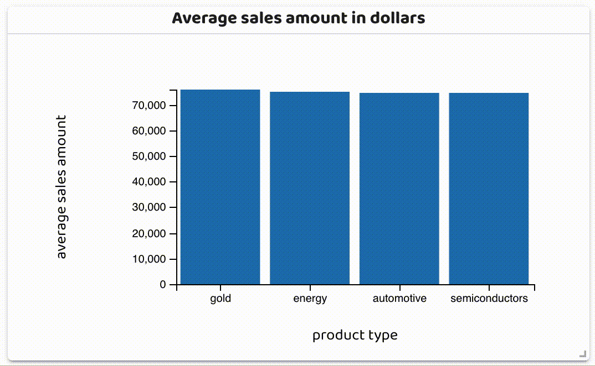
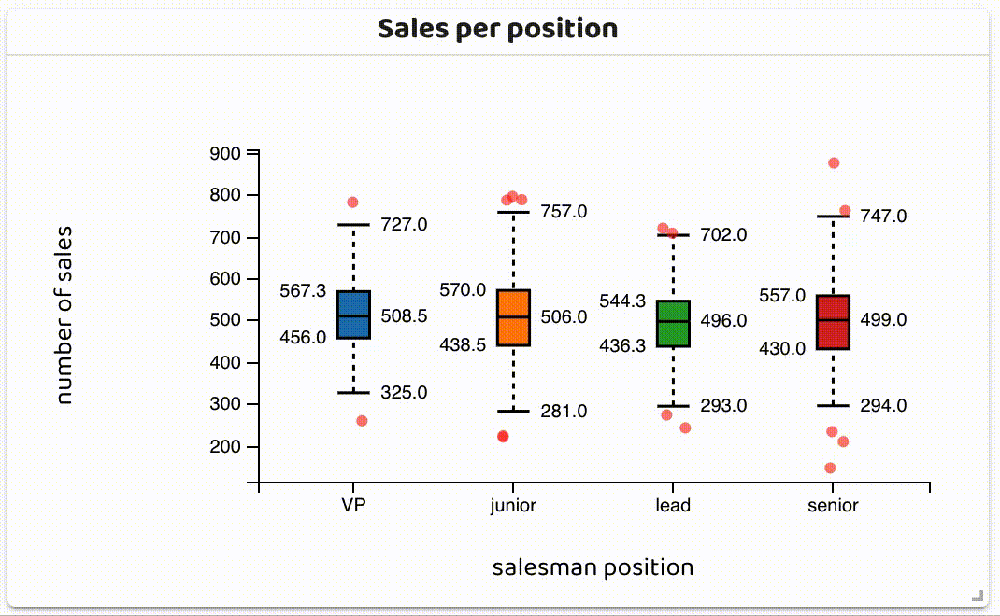
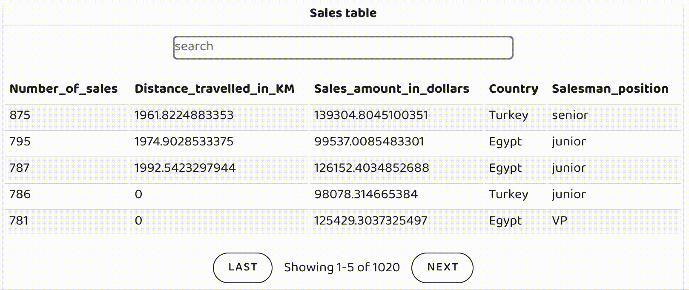
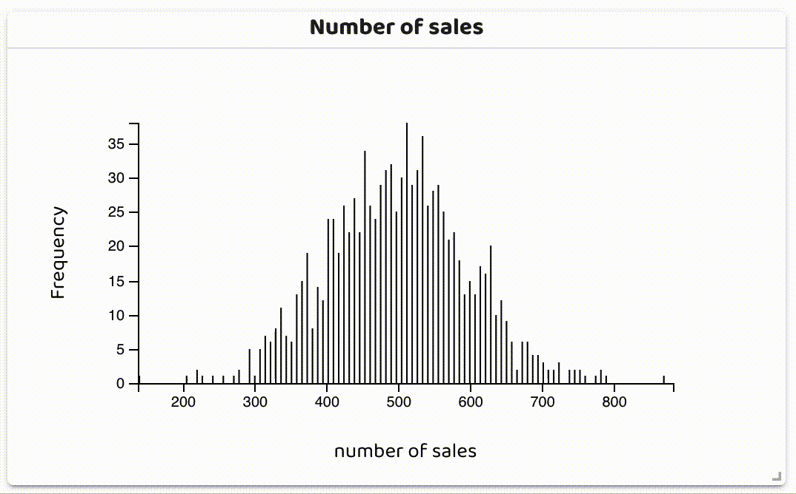
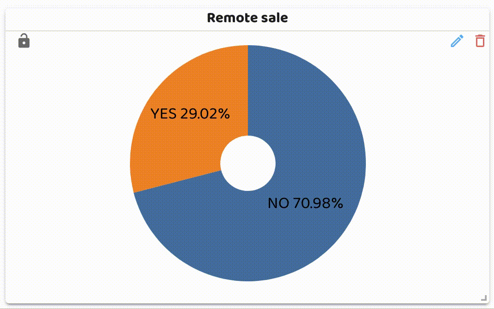
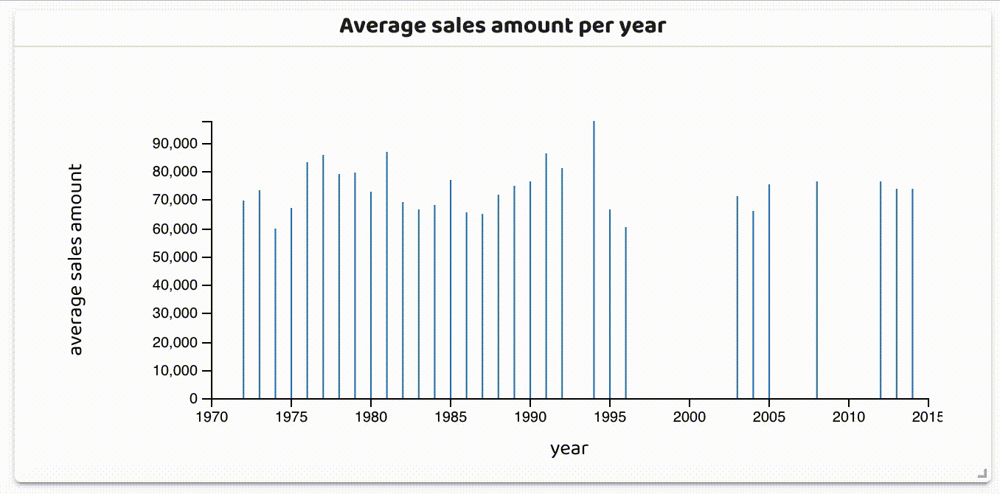
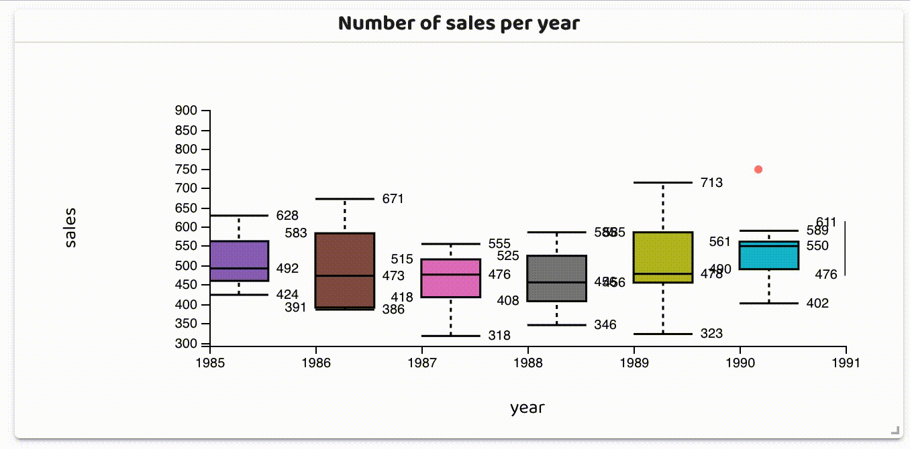

 
 

 

 

 

 
 

<h3>
<a href="../../issues/new">:speech_balloon: Haz una pregunta</a> &nbsp;&nbsp;&nbsp;&nbsp;&nbsp;&nbsp;&nbsp;&nbsp; <a href="../../issues?q=is%3Aissue+is%3Aclosed+sort%3Aupdated-desc">:book: Revisa preguntas</a>
</h3>

# OlliePy
> **OlliePy** es un paquete de Python que puede ayudar a los científicos de datos a
> explorar sus datos y evaluar y analizar sus experimentos de aprendizaje automático
> utilizando el poder y la estructura de las aplicaciones web modernas. 
> El científico de datos solo necesita proporcionar los datos y cualquier información
> requerida, y OlliePy generará el resto.

##  Documentación
Comienza siguiendo la [guía](https://ahmed-mohamed-sn.github.io/olliePy/)

### Instalación
`pip install -U olliepy`

### Soporte de sistemas operativos
- Linux
- MacOs
- Windows (desde la versión v0.2.6+ de olliepy)

### Ejemplos
Comienza utilizando los [ejemplos](https://github.com/ahmed-mohamed-sn/olliePy/tree/master/examples) proporcionados

## Informe de análisis de errores para regresión
**OlliePy** puede ayudarte a realizar análisis de errores para problemas de regresión.

### Características
- Comparar diferentes conjuntos de datos
- Comparar diferentes grupos de error en tus datos.
- Verificar cambios en los datos (data shift) utilizando los informes de características numéricas y categóricas
- Verificar cambios conceptuales (concept shift) utilizando el informe de patrones

##   Panel interactivo
**OlliePy** también puede ayudarte a crear un panel interactivo en minutos.
El panel puede utilizarse para el EDA o para el análisis de errores en problemas de clasificación o regresión.
El rendimiento del panel depende del tamaño de los datos, el número de gráficos y las especificaciones del equipo utilizado.

### Características
- Gráficos arrastrables y redimensionables
- Filtrado cruzado
- Elige entre 14 gráficos personalizables diferentes
- Se pueden aplicar diferentes agregaciones
- Gráficos con función de búsqueda
- Crear nuevos gráficos
- Editar gráficos existentes
- Eliminar gráficos
- Modo oscuro
- Función de guardado automático
- Los gráficos pueden bloquearse en su posición
- Pantalla completa
- Agrupar características numéricas para usarlas en mapas de calor, gráficos de filas, etc.

### Gráficos disponibles 
|                                                                                                   |                                                                                                |
|:-------------------------------------------------------------------------------------------------:|:----------------------------------------------------------------------------------------------:|
|            **Gráfico de barras**            |            **Diagrama de caja**            |
|          **Tabla de datos**           |            **Mapa de calor**             |
|            **Histograma**            |       **Mapa de Leaflet**        |
| **Visualización numérica**    |          **Gráfico circular**           |
|            **Gráfico de filas**            |      **Gráfico de dispersión**      |
|            **Gráfico de sol radiante**            |   **Gráfico de barras temporal**   |
|      **Diagrama de caja temporal**      | **Gráfico de líneas temporal**  |

## Hoja de ruta de OlliePy
- [x] Informe de análisis de errores para regresión
- [x] Panel interactivo
- [ ] Panel interactivo incrustado
- [ ] Informe de evaluación y comparación de modelos de aprendizaje automático que incluye interpretación del modelo y verificación de sesgos
- [ ] Informe de análisis de errores para clasificación
